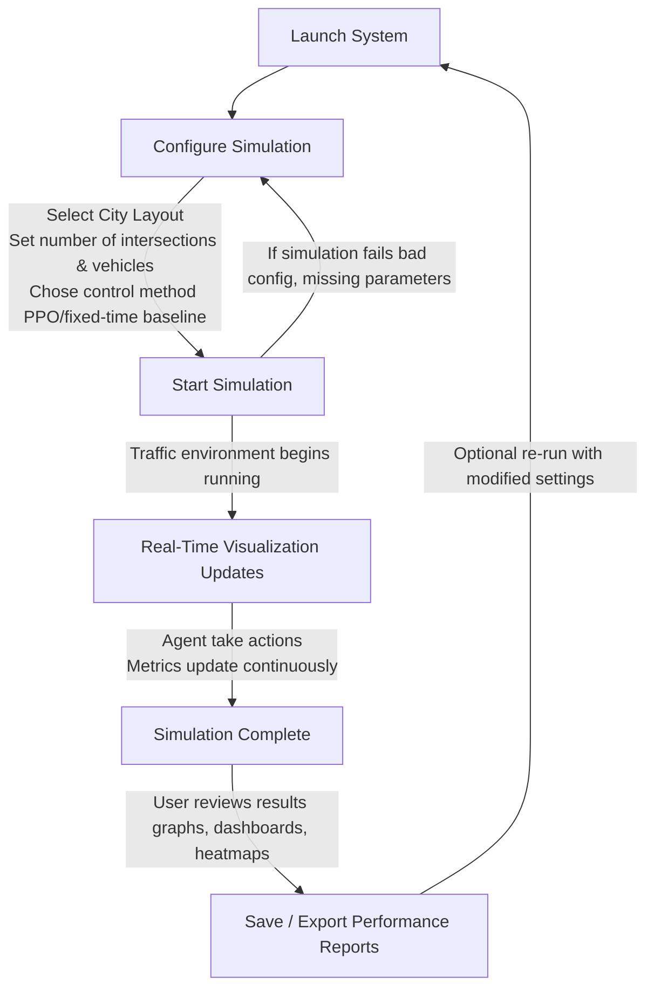
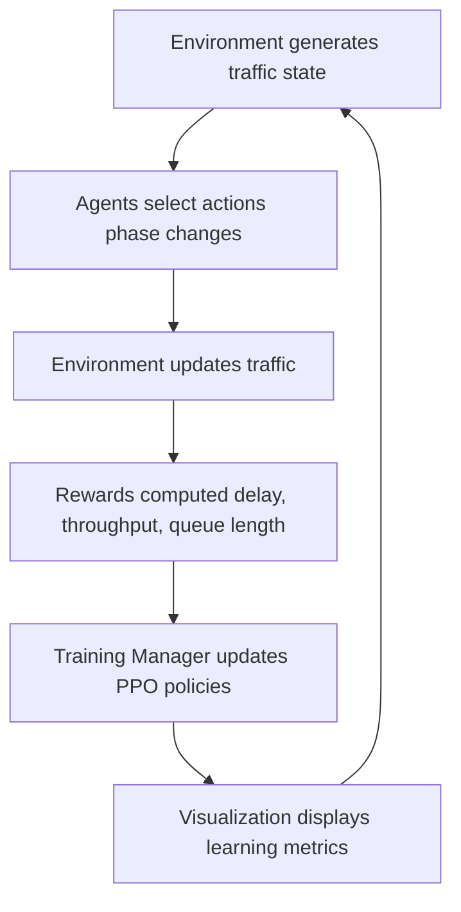
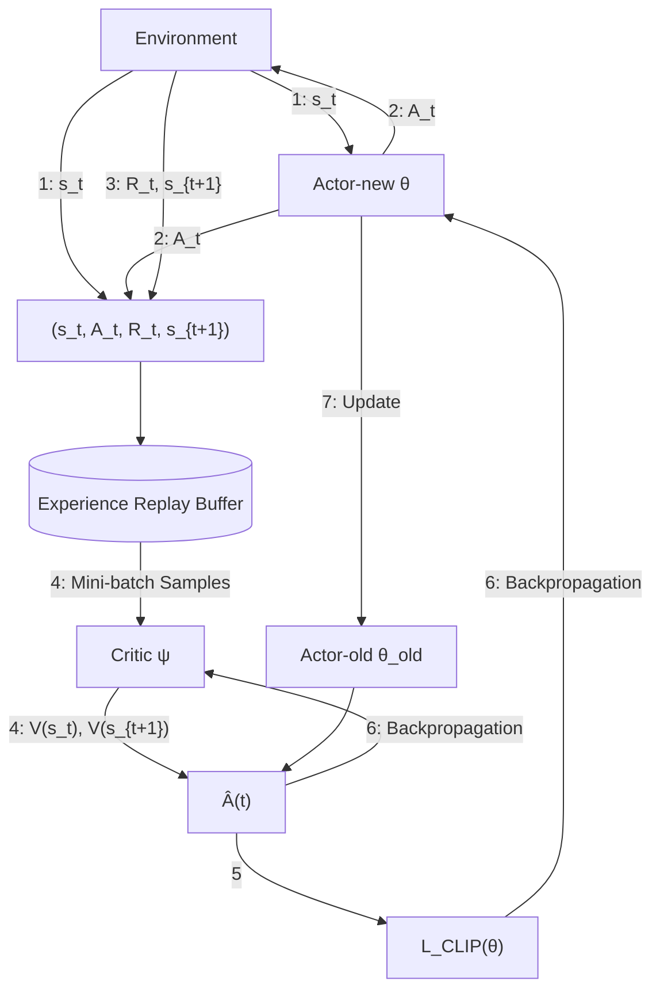
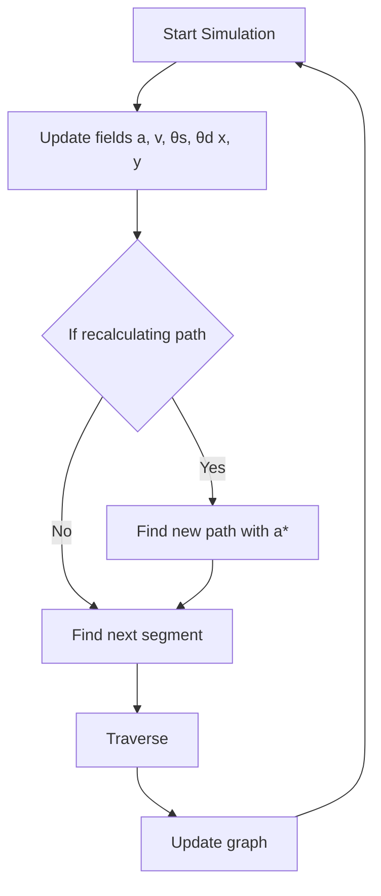
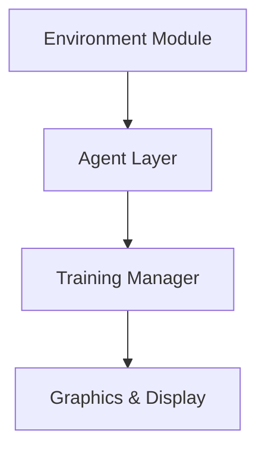
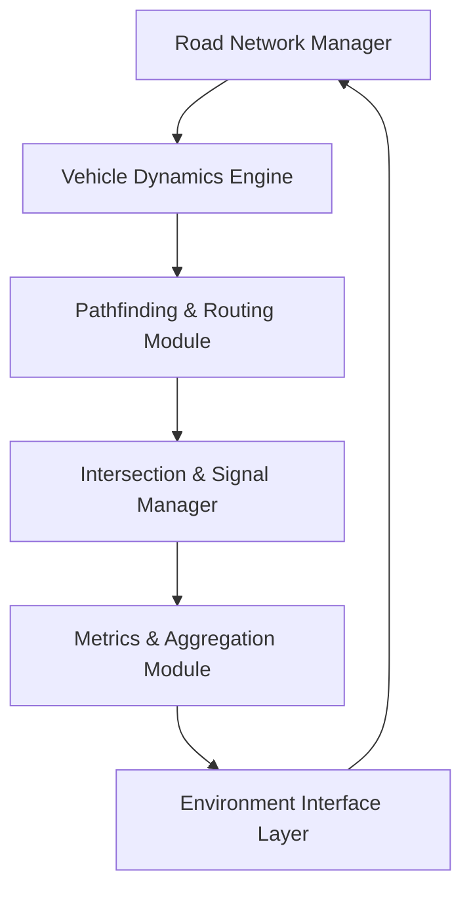
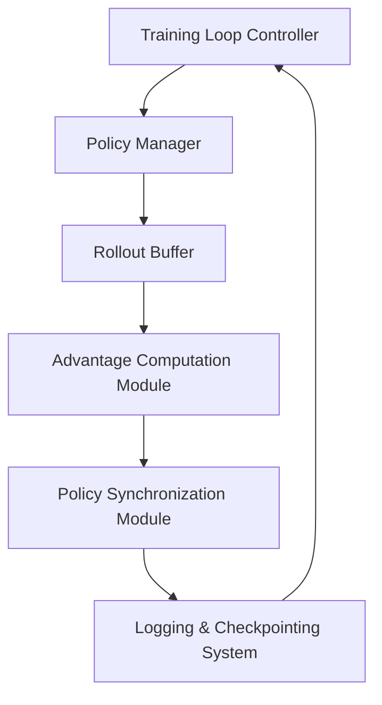
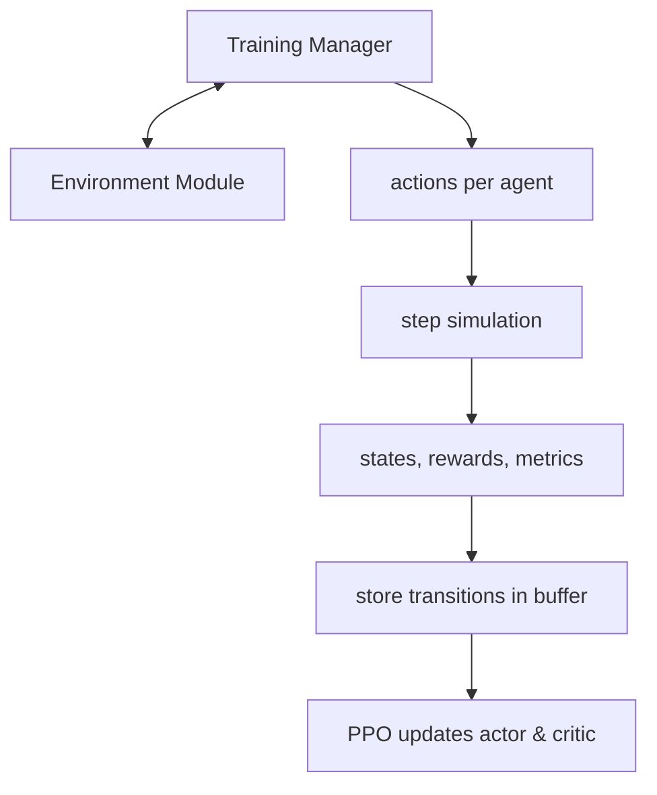

# Now live at https://citypulse.sethdavidkay.com

# Table of Contents

| Section | Page |
| :--- | :--- |
| **1. Table of Contents** | p. 1 |
| **2. Abstract** | p. 2 |
| **3. User Stories** | p. 4 |
| **4. Flow Diagrams** | p. 5 |
| **5. Mockups & Wireframes** | p. 8 |
| **6. Technical Specifications** | p. 11 |
| &nbsp;&nbsp;&nbsp;&nbsp;a. Environment Module | p. 12 |
| &nbsp;&nbsp;&nbsp;&nbsp;b. Training Manager | p. 13 |
| &nbsp;&nbsp;&nbsp;&nbsp;c. Joint Diagram | p. 14 |
| **7. External APIs and Frameworks** | p. 15 |
| **8. Algorithms** | p. 17 |
| &nbsp;&nbsp;&nbsp;&nbsp;a. Proximal Policy Optimization (PPO) | p. 17 |
| &nbsp;&nbsp;&nbsp;&nbsp;b. Reward Computation | p. 20 |
| &nbsp;&nbsp;&nbsp;&nbsp;c. Simulation | p. 20 |

NO AI USED IN CREATION OF CityPulse, ONLY AI CREATED
---

# Abstract

CityPulse is a city-scale traffic simulation platform that uses Multi-Agent Reinforcement Learning (MARL) to control traffic signals in a way that optimizes traffic flow, minimizes congestion, and adapts to complex road structures. Our system leverages reinforcement learning (RL), a branch of artificial intelligence where agents learn optimal behaviour through trial and error, to train autonomous traffic light controllers. Our simulation is entirely custom-built in C, without relying on external ML libraries. This gives us maximum performance and transparency, as well as low-level control of traffic simulation, agent policy, and rendering using a modular architecture. CityPulse's rigorous technical implementation gives full visibility into every layer of the system: from agent decision logic, to the traffic simulation engine, to rendering and interactivity.

Urban traffic congestion is a persistent global challenge. It leads to significant time loss, fuel consumption, and environmental degradation. Traffic light timings are one element impacting congestion and safety in urban environments. Traditional traffic light systems use fixed timers or centralized coordination, which lack the flexibility to adapt to dynamic, real-traffic patterns. Existing smart traffic systems often require centralized data collection or rely on idealized grid layouts, limiting their applicability to the irregular road networks seen in real cities. Our system addresses this by simulating irregular intersection layouts and using agents that act independently with no inter-agent communication, creating a testbed for decentralized coordination under realistic constraints.

The target audience includes urban mobility researchers, smart city infrastructure teams, transportation engineers, and academic institutions interested in reinforcement learning or traffic optimization. Our users likely have a background in transportation, AI, or policy planning. Users can analyze agent performance, modify learning policies, or simulate their own maps. The inclusion of a physics engine for realistic car behaviour and a graphical UI for monitoring traffic states makes the platform both educational and research-capable.

CityPulse introduces several key innovations. First, we support non-grid urban layouts, allowing the simulation of real-world city geometries. Second, we implement Proximal Policy Optimization (PPO) a powerful RL algorithm from scratch enabling full control and extensibility. Third, we adopt a decentralized control paradigm, with each traffic light functioning as a standalone agent. This contrasts with prior approaches that assume global knowledge or rely on complex coordination mechanisms. By forcing each agent to make decisions based solely on local observations, we explore how intelligent policies can emerge from bottom-up learning, a crucial property for scalable urban systems.

Our broader societal impact is to democratize experimentation with smart traffic systems and provide a realistic platform for studying how AI can support urban infrastructure. As global urbanization accelerates, it is crucial to design systems that can adapt and scale without centralized failure points. CityPulse empowers researchers and students to experiment with these challenges in a controlled but realistic environment, contributing to both educational and technological advancement.

CityPulse is an original and technically ambitious project that combines algorithmic learning, systems programming, and real-world impact. By building every component from scratch and focusing on unique constraints like irregular map geometry and decentralization, we aim to produce a simulator and agents that push the boundaries of traffic research and pave the way for smarter, more resilient urban mobility systems.

---

# User Stories

* **As a City Planner**, I want to run city-scale simulations with adjustable traffic-signal policies so that I can evaluate congestion reduction under different control strategies.
* **As a Researcher**, I want to compare MARL-based control with fixed-timer and actuated baselines so that I can quantify performance improvements.
* **As a Developer**, I want to configure network size, intersection geometry, and vehicle inflow so that I can test scalability and stress the system.
* **As a Traffic Engineer**, I want to view live metrics: queue length, delay, throughput, so that I can monitor how agents adapt in real time.
* **As a Student User**, I want to replay previous training runs and visualize agent decisions so that I can understand how reinforcement learning changes overtime.

---

# Flow Diagrams









---

# Mockups & Wireframes

The end user sees two main screens: first, the main dashboard, where they can choose from their saved environments, create a new environment, or delete an environment. They can view info about each environment, including info about individual runs within each, as well as how much disc space is being used by the saved files. The right side of the dashboard shows a preview of the currently selected environment.

### Main Dashboard Wireframe
```
+-----------------------------------------------------------------------------------+
| CITYPULSE                                                                 - [] X  |
+--------------------------+--------------------------------------------------------+
| [Play/Pause/Controls]    | 87 Mb    5 runs (max 12:07:18)           [Search All]  |
|                          +--------------------------------------------------------+
| Environments             |                                                        |
| +----------------------+ |       |   |                                 |   |      |
| | KOGAN PLAZA        > | |  =====+===+=====                       =====+===+===== |
| | WALL STREET        > | |       |   |                                 |   |      |
| | VIA APOLLO         > | |       |   |                                 |   |      |
| |                      | |       |   |________                 ________|   |      |
| |                      | |       |            \               /        |   |      |
| |                      | |       |             \             /         |   |      |
| |                      | |       |              |           |          |   |      |
| |                      | |       |              |           |          |   |      |
| |                      | |       |   |----------+-----------+---|      |   |      |
| +----------------------+ |       |   |                          |      |   |      |
| [New] [Duplicate] [+]    |                                                        |
+--------------------------+--------------------------------------------------------+
| 3 Environments    257Mb  | Kogan Plaza                                [-][+] 100% |
+--------------------------+--------------------------------------------------------+
```

After opening an environment, the user sees the map in full, with the map editor on the left side of the screen. The top bar lets the user control the simulation speed, including pausing the simulation. The map view shows active pedestrians and vehicles, with an optional "model" window (shown opened below) with which the user can edit model parameters in real time to prioritise certain outcomes over others (for instance, to give more priority to safety over travel speed).

### Map Editor & Model Parameters Wireframe
```
+-----------------------------------------------------------------------------------+
| CITY PULSE                                                                - [] X  |
+-----------------------------------------------------------------------------------+
| [Controls]   23Mb         42 Pedestrians         7 Vehicles               [Search]|
+--------------------------+--------------------------------------------------------+
| Map Editor               |         ^  ^                                    |  |   |
| +----------------------+ |         |  |                                    |  v   |
| |                      | |     ====+==+====                            ====+==+== |
| |                      | |         |  |   +-----------------------+        |  |   |
| |                      | |         |  |   | MODEL             [X] |        |  |   |
| |                      | |         |  |   +-----------------------+        |  |   |
| |                      | |         |  |   | Mode         [Value v]|        |  |   |
| |                      | |         |  |   |                       |        |  |   |
| |                      | |         |  |   | Parameters            |        |  |   |
| |                      | |         |  |   | Value 1  [---o-----]  |        |  |   |
| |                      | |         |  |   | Value 2  [-----o---]  |        |  |   |
| |                      | |         ^  |   | Value 3  [---o-----]  |        |  v   |
| |                      | |         |  |   | Value 4  [--o------]  |        |  |   |
| |                      | |         |  |   | Value 5  [----o----]  |        |  |   |
| |                      | |         |  |   | Value 6  [------o--]  |        |  |   |
| +----------------------+ |         |  |   | Value 7  [---o-----]  |        |  v   |
| [Delete] [Duplicate] [A]|         |  |   +-----------------------+        |  |   |
+--------------------------+--------------------------------------------------------+
| Run 5 | Elapsed 12:07:18 | Kugan Plaza                                [-][+] 100% |
+--------------------------+--------------------------------------------------------+
```

None of this requires interfacing with an external API, as it is all implemented in our custom immediate-mode UI. To give a sense of how our UI system is used, the below image is a real screenshot of an example program we produce with the following code:

```c
// at startup:
Ui *ui = &(Ui) { .platform = platform };
ui_create(ui);

// every frame:
ui_begin(ui);
ui_parent(ui, Ui_Axis_Y) {
    ui_text(ui, "Segments");
    static bool show_corners = false;
    if (ui_button(ui, "toggle corners")->clicked) {
        show_corners = !show_corners;
    }
    for (u64 i = 0; i < segments.count; i += 1) {
        Segment *segment = &segments.data[i];
        ui_parent(ui, Ui_Axis_X) {
            ui_text(ui, "%", fmt(u64, i));
            if (ui_button(ui, "click to highlight##%", fmt(u64, i))->clicked) {
                // mark segment highlighted (code omitted for brevity)
            }
        }
        if (show_corners) {
            ui_text(ui, /* omitted for brevity */);
        }
    }
    ui_text(ui, "%", fmt(String, print_path(platform->frame_arena, state.vehicles.data[0].path)));
}
ui_end(ui);
ui_default_render_passthrough(ui);
```

---

# Technical Specifications

### General Spec
* **Environment Module** - generates state
* **Agent layer** - independent PPO controllers
* **Training Manager** - collects trajectories and updates policies
* **Graphics & display** - visualize metrics & models real-time environment

Data flow: **states $\rightarrow$ action $\rightarrow$ reward $\rightarrow$ update $\rightarrow$ display**



---

## Environment Module



* **Road network manager** stores metrics and geometries, loads the topological graph, and provides spatial lookups
* **Vehicle dynamics engine** updates vehicle physics, models car dynamics, and produces and analyses collision metrics
* **Pathfinding and routing module** triggers A* when necessary, considers vehicle personality for route selection and behavior, and assigns paths for each vehicle
* **Intersection and signal manager** maintains signal phase for each intersection, and handles RL agent action outputs
* **Metrics and aggregation module** computes RL features per intersection, such as segment metrics and average wait time
* **Reward computation module** implements $r_i(t) = -\alpha Q_i(t) - \beta W_i(t) + \gamma F_i(t) - \delta \Delta P_i(t)$ (read more in algorithms) and logs raw metrics
* **Environment Interface Layer** provides functions used by the training manager, such as `reset`, `step`, `get_state`, `get_segment_est_reward`, and `get_done`

---

## Training Manager



*Read more in Algorithms: PPO*

---

## Joint Diagram

### The Environment Module and Training Manager Together



*Read more in algorithms: PPO and algorithms: Simulation*

---

# External APIs and Frameworks

### Sokol [external]
[https://github.com/floooh/sokol](https://github.com/floooh/sokol)
Sokol is a cross-platform graphics library which serves as a kind of minimal possible abstraction across platform-specific graphics APIs (DirectX 11 on Windows, Metal on macOS, OpenGL on Linux, and WebGL or WebGPU on web). We're using not only the `sokol_gfx.h` component—the graphics API itself—but also `sokol_app.h` for cross-platform windowing and mouse/keyboard input. Finally, the `sokol-shdc` shader cross-compiler lets us write our shaders (both graphical and compute) once, in an annotated dialect of GLSL, and cross-compile to the shader languages required by the platform-specific graphics APIs sokol supports.

We've architected our codebase in such a way that all interactions with sokol are in the "platform layer", which is what the application code interfaces with. This means that switching to different windowing and graphics APIs—say, SDL3 with WebGPU, or custom platform-specific implementations—requires only an alternate platform implementation, while our application code stays the same. Indeed, we could experiment with multiple implementations at once if need be.

### Base layer [external, but internally developed]
The "base layer" is an alternate standard library such that we have no usage of the terrible C standard library, beyond the unfortunately necessary linking of libc for sokol. Some of the things it provides are:
* Length-terminated strings and associated functions;
* Type-safe "slices" (fat pointers), dynamic arrays, intern pools, and hashmaps;
* Malloc-less manual memory management via arenas, with runtime safety checking in debug builds;
* Linear algebra and math functions;
* Metaprogramming;
* OS file operations;
* Extensible platform interface;
* Intrinsics for breakpoints, panics, and unreachable code;
* A multi-platform `build.c` which supports multiple C compilers (no Makefiles or CMake!);
* Custom immediate-mode UI.

Casting aside libc lets C be as productive and viable as any modern language, or more so.

### Python [not a build dependency]
In the research portion of this project, we've used python, along with matplotlib and numpy, for data analysis and visualisation. It is not a dependency of our product.

### Git and GitHub [not a build dependency]
Once again, these are not dependencies of our output product, but rather "development dependencies". We use git and GitHub to manage feature development in parallel, create and review pull requests, merge code, and track our progress via the project board.

---

# Algorithms

## Multi-Agent PPO for Traffic Signal Control

### Goal
Train a separate reinforcement learning agent at each intersection to learn traffic-signal control policies that reduce average waiting time, queue length, and congestion, while keeping policy updates stable in a multi-agent setting.

### Description
CityPulse uses Proximal Policy Optimization (PPO) in a multi-agent actor-critic setup:
* Each intersection $i$ is controlled by its own PPO agent.
* Each agent has:
  * An actor network that parametrizes the policy $\pi_{\theta_i}(a|s)$, which outputs a distribution over actions (signal phases).
  * A critic network that approximates the state-value function $V_{\phi_i}(s)$, which predicts how good a state is.
* Training process in iterations. In each iteration, all agents interact with the simulated environment to collect trajectories (rollouts), and then use those trajectories to update their policies.

PPO's key idea is to perform policy-gradient updates while preventing overly large policy changes using a clipped surrogate objective. This stabilizes learning, which is especially important when multiple agents are updating in parallel and changing each other's environment.

### Inputs
For each agent (intersection) $i$:
* **State $s_i(t)$**: A feature vector constructed from local traffic conditions such as:
  * Lane occupancies
  * Queue lengths per approach
  * Aggregate waiting time
  * Current signal phase and how long it's been active
* **Action $a_i(t)$**: A discrete choice representing the next signal phase configuration, e.g.:
  * North-south green, east-west red
  * East-west green, north-south red
  * All-red/transition phase
* **Reward $r_i(t)$**: A scalar value computed from local traffic metrics (reward algorithm below) typically penalizing delay and queues and rewarding good throughput.
* **Old policy parameters $\theta_{\text{old},i}$**: Snapshot of the policy used to generate the current trajectories.
* **Value parameters $\phi_i$**: Parameters of the critic network used to estimate $V_{\phi_i}(s_i)$.

### Outputs
* Updated actor parameters $\theta_i$ for each intersection.
* Updated critic parameters $\phi_i$.
* Training statistics per iteration, such as:
  * Average return per agent
  * Policy loss, value loss
  * Approximate KL divergence between old and new policies

### Core Steps per Training Iteration

#### 1. Trajectory Collection (Rollouts)
For a fixed horizon $T$ (or a number of episodes):
For each timestep $t$ and each intersection $i$:
1. The agent observes state $s_i(t)$
2. The actor samples an action $a_i(t) \sim \pi_{\theta_{\text{old},i}}(\cdot | s_i(t))$
3. The environment applies all agents' actions and advances one simulation step
4. The agent receives reward $r_i(t)$ and next state $s_i(t+1)$
5. Store $(s_i(t), a_i(t), r_i(t), s_i(t+1))$ in a rollout buffer for all agents

#### 2. Value and Advantage Estimation
* Compute returns or rewards-to-go for each timestep.
* Uses the critic network $V_{\phi_i}$ to estimate values $V_{\phi_i}(s_i(t))$.
* Compute advantage estimates $\hat{A}_i(t)$ which measures how much better the taken action was compared to what the critic predicted (e.g. using GAE or simple TD advantage).

#### 3. Policy Ratio Computation
For each stored sample, compute the probability ratio:
$$r_i(t) = \frac{\pi_{\theta_i}(a_i(t)|s_i(t))}{\pi_{\theta_{\text{old},i}}(a_i(t)|s_i(t))}$$
This ratio tells us how much the new policy differs from the old one for that action.

#### 4. Clipped Surrogate Objective (Actor Update)
PPO maximises the following objective (conceptually):
* Increase the objective when actions with positive advantage get higher probability.
* Decrease it when actions with negative advantage get higher probability.
* Clip the ratio $r_i(t)$ to a small range (e.g., $[1-\epsilon, 1+\epsilon]$) so that updates cannot push the policy too far from the old one.

In practice, we take mini-batches from the rollout buffer and perform several epochs of stochastic gradient ascent on this clipped objective for the actor parameters $\theta_i$.

#### 5. Value Function Update (Critic)
For the critic, minimize the mean squared error between predicted values $V_{\phi_i}(s_i(t))$ and empirical returns. Perform gradient descent updates on $\phi_i$ using the same mini-batch structure.

#### 6. Parameter Synchronization
After finishing the update epochs:
* Set $\theta_{\text{old},i} \leftarrow \theta_i$ for the next training iteration.
* Clear the rollout buffer and repeat the process with new trajectories.

### Algorithmic Complexity
Let:
* $N =$ number of agents (intersections)
* $T =$ rollout length per iteration
* $k =$ approximate number of parameters/cost per network update

* **Trajectory collection**: $O(N \cdot T)$ environment steps
* **PPO updates**: For each epoch and mini-batch, complexity is roughly $O(N \cdot T \cdot k)$

Because rollouts and value computations are independent across intersections and timesteps, many parts of this process can be batched and parallelized.

---

## Reward Computation for Traffic Signal Agents

### Goal
Provide each traffic signal agent with a scalar reward that encourages reduced congestion, shorter wait times, and smoother traffic flow, all while discouraging behaviours like excessive phase switching.

### Description
At every simulation step, each intersection $i$ receives a reward signal derived from measurable local traffic performance indicators. The reward is designed to penalize queue buildup, vehicle delay, waiting time and to reward efficient throughput, while optionally discouraging rapid, unnecessary signal switching. This shapes the RL objective toward both intersection performance and global traffic movement without direct inter-agent communication.

### Inputs
Per intersection $i$, per timestep $t$:
* $Q_i(t)$: Queue length (e.g. number of cars stopped per approach)
* $W_i(t)$: Total or average waiting time of vehicles in queue
* $F_i(t)$: Flow/throughput (vehicles successfully exiting intersection)
* $\Delta P_i(t)$: Phase change indicator (1 if changed this step, else 0)

These metrics are collected from the traffic simulation engine.

### Outputs
Scalar reward: $r_i(t)$

### Reward Function
We use a weighted, shaped reward:
$$r_i(t) = -\alpha \cdot Q_i(t) - \beta \cdot W_i(t) + \gamma \cdot F_i(t) - \delta \cdot \Delta P_i(t)$$

Where:
* $-\alpha \cdot Q_i(t)$ reduces queue lengths
* $-\beta \cdot W_i(t)$ prevents long waits/gridlock
* $+\gamma \cdot F_i(t)$ encourages smooth traffic management
* $-\delta \cdot \Delta P_i(t)$ avoids flickering signals

All coefficients $\alpha, \beta, \gamma, \delta$ are tunable hyperparameters. This enables experimentation; different weighting can emphasize local vs global traffic optimization.

### Core Steps (every timestep)
1. Read lane-level metrics from environment.
2. Aggregate per-lane values into intersection level metrics $Q_i(t)$, $W_i(t)$, $F_i(t)$.
3. Compute reward using the weighted formula above.
4. Store $r_i(t)$ along with transitions $(s_i(t), a_i(t))$ in PPO rollout buffer.
5. Log raw metrics for evaluation, independent of RL reward shaping.

### Algorithmic Complexity
The computation per intersection is $O(1)$, given pre-aggregated lane data. Overall reward update scales linearly with number of agents: $O(N)$ per timestep.

### Why this works
Rewards are simple, differentiable proxies for congestion but reliably drive improvements in average delay, queue buildup, and intersection throughput, without requiring explicit coordination or communication between agents.

---

## Multi-Agent Simulation for PPO training

### Goal
Create a realistic simulation based on real-world data to generate realistic states to train PPO on, with the ultimate goal of traffic signal control. Provide realistic, dynamic, and efficient traffic simulation of any real-world grid structure. This environment is used to then train our RL agents, allowing them to base their observation on close to real-world data with fast and efficient feedback, all while receiving reward feedback based on congestion and flow metrics.

### Description
The simulation models:
* Vehicles based on heavy physics networks and real-world path-finding algorithms, all inside of a real world city geometry highly dynamic simulation environment.
* Road segments with entrance and exit conditions, speed limits, lane definitions, arbitrary (completely dynamic) traffic control definitions, and crash physics.
* Intersections with signal controlled by our RL agents.
* Traffic flows based off of real-world car-following, queuing, and proper (and sometimes improper) real-world behavior.
* Pathfinding based off of real-world accidents, and vehicles that don't always follow the rules of the road.
* Vehicle behaviors assigned at creation based off of real-world means and standard deviations giving vehicles the ability to make incorrect decisions.

Each simulation step updates all vehicle physics fields (acceleration, velocity, steering angle, car angle, and position in three dimensions), recalculated paths for some cars, finds new paths for those cars, and traverses each car to their next segment, updating the graph and segments, which produces the system state that PPO agents then observe.

The environment ensures:
* Accurate queuing at intersections.
* Vehicle-independent path-finding using a very custom and complex heuristic network and A* search.
* State extraction for RL (wait times, segment occupancy, accident informatics).
* Single-phase changes for all agent actions.
* Fully realistic using our custom physics network acceleration, deceleration, gap acceptance, reaction times, and vehicle movement/turns.

### Inputs

#### Network Structure
* Graph of segments which include roads, lanes, intersections, and roundabouts; can also dynamically adapt to any needed real-world road structure.
* Entry and exit conditions which dynamically include any needed traffic rules and specifications.

#### Vehicle Parameters
For each vehicle:
* Current position, steering angle, car angle, velocity, and acceleration (and more for intelligent under the hood physics calculations for edge cases).
* Path to take.
* Destination segment.
* Personality (cautious, aggressive, late to use their turn signal, late to react to other cars, etc.).

#### Traffic Demand
* Vehicle spawn rates and positions.
* Intelligent and dynamic origin-destination distributions.
* Time-varying flow patterns (time of day, road work, etc.).

#### Signal Phases
* The action outputs from PPO agents.
* Phase definitions.

### Outputs
At every simulation timestep:
* Vehicle states, as described above.
* Segment congestion and metrics.
* Intersection congestion and metrics.
* State vectors (for RL training).
* Reward value for each segment and a custom definition for each intersection.

#### Logging
* Average delay.
* Crashes, and associated severity levels.
* Average throughput.
* Total time stopped.
* Full graph congestion analytics.

### Core Simulation Loop (Environment Step)
Each timestep consists of three major update layers:

#### 1. Vehicle Physics and Movement
**Physics Updates**
For each vehicle:
* Update acceleration based on:
  * Steering angle
  * Desired steering angle
  * Acceleration
  * Desired acceleration
* Update velocity using acceleration.
* Update car angle and direction.
* Update position in continuous space.
* Map new positions to the segment in our graph.

This models realistic motion and vehicle behaviors.

#### 2. Vehicle Navigation and Pathfinding
**Path Recalculation**
For a weighted amount of a weighted selection of vehicles each time step:
* Get the vehicle's route.
* Run A* on its current segment and destination segment.
* Vehicle personality influences weighting (with a very custom heuristic structure).

**Segment Traversal Logic**
* Determine which segment we are in.
* Update segment-specific metrics for logging and outputs and other vehicles path calculations.
* Handle entry and exit conditions when moving between segments:
  * Stop if red light.
  * Move towards end of segment if green light.
  * Enter dynamic queue if blocked (queues emerge naturally).

#### 3. Intersection and Signal Modeling
Each intersection controller:
* Reads the current signal phase.
* Reads segment constraints.
* Applies the actions selected by the RL at the previous timestep.
* Updates internal timers.
* Will be slightly different if the continuous time and continuous space model performs better, where each time step will be determined dynamically both by the policy and by custom timer interrupts outputs.

This layer determines how traffic can move through intersection based off of the RL.

#### State Extraction for RL Agents
Per intersection $i$, the simulation computes:
* **Naturally-Emerging Queue Metrics**:
  * Dynamic queue lengths per vehicle
  * Number of vehicles at a stand still
  * Time spent at a stand still per each vehicle
* **Flow Metrics**:
  * Vehicles exiting per timestep
  * Turn-specific flow counts
* **Occupancy Metrics**:
  * Segment congestion
  * Nearby segment counts with vehicles approaching and leaving
* **Signal and Timing Features**:
  * Current phase
  * Time elapsed in current phase
  * Time since last signal change and segment change

These form the state vector $S_i(t)$.

#### Reward Computation (Environment Component)
The simulator computes the following metrics for the RL agent, as well as passing in the data as a whole to the critic neural network:

$$r_i(t) = -\alpha Q_i(t) - \beta W_i(t) + \gamma F_i(t) - \delta \Delta P_i(t)$$

Where:
* $Q_i(t)$ is our intelligent queue length
* $W_i(t)$ is our dynamic wait time
* $F_i(t)$ is our throughput average
* $\Delta P_i(t)$ is a dummy variable explained by whether the signal changed this step or not

These rewards emerge dynamically from our simulation measurements.

### Algorithmic Complexity
Let:
* $V =$ total count of vehicles
* $N =$ total count of segments grouped into intersections
* $E =$ total count of segments

Per timestep complexity:
* Vehicle physics: $O(V)$
* Pathfinding: amortized $O(V \log E)$
* Intersection Logic: $O(N)$
* Segment updates: $O(E)$
* Segment extraction: $O(N)$

**Total per-step**: $O(V + N + E)$, which scales linearly with graph size and total vehicle count.

### Algorithm: Vehicle Simulation Step

```
1: function SIMULATE(vehicle, graph, time)    ▷ Perform physics and navigation update for the vehicle at the given time
2:     // Physics updates
3:     UpdateAcceleration(vehicle)
4:     UpdateVelocity(vehicle)
5:     UpdateSteering(vehicle)
6:     UpdateDirection(vehicle)
7:     UpdatePosition(vehicle, time)
8:
9:     // Pathfinding updates
10:    if ShouldRecalculatePath(vehicle, time) then
11:        newPath <- AStarSearch(graph, vehicle.position, vehicle.targetPosition, vehicle.personality)
12:        vehicle.path <- newPath
13:    end if
14:
15:    // Segment traversal
16:    currentSegment <- FindSegment(graph, vehicle.position)
17:    if currentSegment != NULL then
18:        vehicle.currentSegment <- UpdateGraphSegment(graph, vehicle, currentSegment)
19:    end if
20:    return vehicle
21: end function
```

### Why This Simulation Works for RL Training
* Produces realistic models.
* Provides stable, dynamic, fast, and efficient realistic traffic behavior.
* Provides continuous feedback to RL agents.
* Dynamically supports unprepared traffic rules and road structures found in real-world city geometries.
* Supports large road networks.
* Real-vehicle interactions emerge naturally.
* Able to extract all necessary information for RL learning.
